# 🤖 Ivan Josef Esposito 

**`Engenharia Biomédica | Visão Computacional | Robótica`**

Sou estudante de Engenharia Biomédica na Universidade Federal de Uberlândia (UFU). Trabalho com visão computacional e aprendizado de máquina aplicados à robótica e à inspeção industrial. Na equipe de robótica EDROM, desenvolvo soluções de percepção e localização para robôs humanoides da RoboCup. No LAPROSOLDA, pesquiso aplicações de visão computacional para inspeção automatizada.

  
  
  

### 🛠️ Linguagens e tecnologias

  
  
  
  
  
  
  
  
  
          

### 📊 Estatísticas do GitHub

  
  

